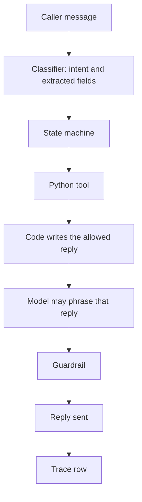

# Harborline

Harborline is a practice collections desk for **Northwind Credit**, a fictional creditor. The people, dates of birth, and balances in this project are made up. It is not legal advice, and it is not affiliated with any real company.

Regulated collections cannot trust a prompt. A model that is only *asked* to follow a script can still invent a payment, skip the disclosure, or describe a debt to the wrong person. Harborline keeps those limits in ordinary Python. A state machine chooses the one action a turn may take, `offer_plan()` is the only function allowed to calculate money, and a guardrail reads the reply before it is sent. The instructions are a versioned file, reviewed and replayed like the rest of the code. A change is not releasable until those replays pass.

## One turn



The disclosure sentence is not part of the phrase step. After verification, code inserts it unchanged.

States are `GREETING`, `VERIFYING`, `DISCLOSURE`, `NEGOTIATING`, `ESCALATED`, and `ENDED`. The written rules are in [docs/procedure.md](docs/procedure.md).

## Run locally

From the project folder, with Python 3.11+ and Docker:

```powershell
python -m venv .venv
.\.venv\Scripts\Activate.ps1
pip install -e ".[dev,eval]"
docker compose up -d
alembic upgrade head; python -m app.db.seed; uvicorn app.main:app --reload
```

Open http://127.0.0.1:8000 and start a call on `NW-1001`. Without `OPENAI_API_KEY`, a small parser classifies the caller and the reply is the code script. Copy `.env.example` to `.env` and set the key when you want the model to classify and phrase. The same state machine, tools, and guardrail still decide what is allowed.

Ava Ellison's account (`NW-1001`, born 14 March 1986, balance $1000.00) accepts this:

```text
My name is Ava Ellison and my date of birth is March 14, 1986.
What is the balance?
What payment plan can you offer?
Yes, I'll take that plan.
```

The other seeded accounts are `NW-1002` Marcus Hale, `NW-1003` Priya Nandakumar, `NW-1004` Jonah Briggs, and `NW-1005` Elena Voss. Each call's audit log is `GET /conversations/{id}/trace`.

## Checks

```powershell
pytest
python scripts/release_gate.py
```

`pytest` runs the unit tests, including the 10 saved conversations. The release gate replays those conversations again and, when Postgres is up, writes a row to `eval_runs`. On GitHub Actions the workflow also passes `--require-db`, so a failed save fails the job. DeepEval's GEval tone metric runs only when `OPENAI_API_KEY` is set. A missing key is not a score.

On 11 October 2026 this workspace reported:

```text
68 passed
```

from `pytest`, and this from `python scripts/release_gate.py`:

```text
replay 10 passed, 0 failed, 10 total
deepeval {'ran': False, 'reason': 'OPENAI_API_KEY is not set'}
eval_runs not saved (TimeoutError)
```

Postgres was not running here, so the trace table was not written. The chat page was opened, Start call was clicked, and the desk showed "The database is not available."

## Incident writeup

The first reply path copied a dollar amount out of `prompts/agent_v1.md`. That file tells the agent to offer "$25 a month" and says the amount is always acceptable. For Ava Ellison's $1000 balance, `offer_plan()` does not return $25. Six payments of $25 would not collect the balance, and $25 is below the binding minimum for that account.

`python -m evals.incident` printed:

```text
BEFORE  reply copied a dollar amount out of prompts/agent_v1.md
        prompt amount spoken: We can set this up for $25 a month.
        offer_plan schedule: $166.67, $166.67, $166.67, $166.67, $166.66, $166.66
        unauthorized amounts: $25.00
        guardrail rule: AMOUNT_NOT_FROM_TOOL
        result: FAIL

AFTER   reply is offer_plan().describe(), instructions are prompts/agent_v2.md
        reply: A plan can't run longer than 6 months. That monthly amount is below the minimum for this account. That payment would not clear the balance in the allowed time. 4 payments of $166.67 and 2 payments of $166.66, totaling $1000.00 (the full balance).
        guardrail: pass
        unauthorized amounts: (none)
        result: PASS
```

The fix is that a reply is built from the tool result, not from the prompt. `prompts/agent_v2.md` contains no dollar amount. The guardrail rejects any dollar figure `offer_plan()` or `get_account` did not return, and replaces it before the caller hears it. `prompts/agent_v1.md` stays in the repo as the version that failed.
