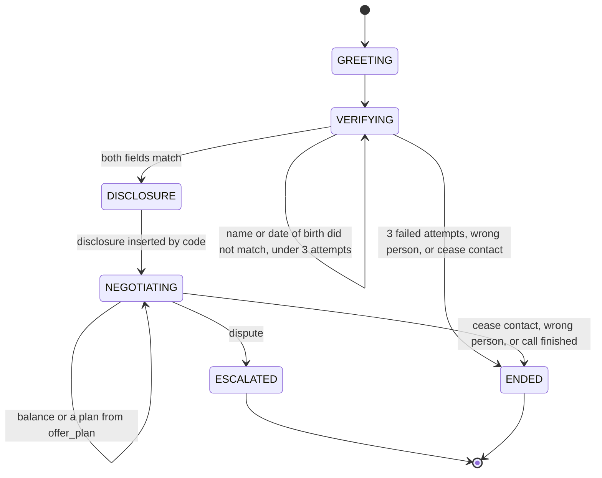

# Harborline collection procedure

This is the procedure for calls about accounts held by **Northwind Credit**, a fictional creditor. The people, dates of birth, and balances in this project are made up. Nothing here is legal advice, and the project is not affiliated with any real company.

The model does not decide what is allowed. Python decides. The model only classifies what the caller said and phrases a reply from the action Python already chose.

## What the caller hears, in order

1. **Greet and verify.** Ask for the caller's full name and date of birth. Both must match the account. Do not say the balance, any dollar amount, or any creditor detail before both fields match. "Creditor detail" includes the creditor's name and the fact that a specific debt is owed.
2. **Disclosure.** After verification, and before any talk of money, Python inserts this sentence by itself. The model must not write it, shorten it, or paraphrase it:

   This is an attempt to collect a debt, and any information obtained will be used for that purpose.

3. **Payment plans.** Only `offer_plan()` may produce a plan. Read the rules below. If the caller asks for something outside those rules, offer the closest plan the function returns, or explain the limit it names. Never invent an amount.
4. **Dispute.** If the caller disputes the debt, do not argue and do not keep negotiating. Log reason code `DISPUTE` and escalate to a human.
5. **Stop calling.** If the caller says to stop calling or to cease contact, end the conversation immediately. Log reason code `CEASE_CONTACT` and mark the account so no further contact happens.
6. **Wrong person.** If the caller is not the account holder, end the conversation. Do not reveal any account detail. Log reason code `WRONG_PARTY`.

A conversation is opened against one known account (the number that was dialed). The system may look at that account. The model must not see the balance, the date of birth, or the creditor name until verification succeeds.

## Verification

- The caller must give **both** the full name and the date of birth. One of the two is not enough.
- The name matches when it is the same name with case and extra internal spaces ignored. A first name alone does not match.
- The date of birth matches only when it is the same calendar date.
- A wrong or incomplete answer is one failed attempt. After **3** failed attempts, end the call politely. Do not reveal why the check failed beyond asking again, and do not reveal the correct values.
- Saying "wrong person", "wrong number", or "I am not that person" is not a failed attempt. End at once under rule 6.

## Payment plans

`offer_plan()` is the only place a monthly amount, a term, or a schedule is calculated. The model never does this arithmetic.

A plan always collects the **full balance**. There is no discount, settlement, waiver, or "pay this much and we will write off the rest."

Three rules apply together:

| Rule | Value |
| --- | --- |
| Minimum monthly payment | `max(10% of the balance, $25)`, rounded up to the cent |
| Maximum term | 6 months |
| Amount collected | The installments sum to the balance exactly |

The monthly amount is the **lowest** figure that satisfies all three at once. Ten percent of the balance, paid for six months, collects only 60 percent, so on larger balances the six-month rule raises the payment above the 10 percent floor. On a small balance, `$25` is higher than 10 percent, and the term is shortened so every installment still meets that floor.

Other plan rules:

- Paying the full balance in one payment is always allowed.
- If the balance is below `$25`, the only plan is one payment of that balance. The floor is not a demand for more than is owed.
- A caller may pay **more** than the minimum per month. The plan then finishes sooner. It still sums to the balance and it is still at most six months.
- The last installment may be a few cents lower than the others so the sum matches the balance to the cent. It still has to meet the minimum monthly payment. That remainder is part of the full balance, not a discount. If a requested payment would leave a last installment below the floor, `offer_plan()` folds that remainder into the schedule instead of billing it.
- `offer_plan()` returns machine-readable reason codes when it changes the request. The reply may explain those codes. It may speak only amounts that appear on the returned plan.

| Caller request | What `offer_plan()` does | Reason code |
| --- | --- | --- |
| Waive, discount, settle for less, or a payment of `$0` | Refuse the waiver. Offer the longest legal full-balance plan. | `NO_WAIVER` |
| Monthly amount below the floor | Raise it to the floor, then apply the payoff rule. | `BELOW_MINIMUM` |
| Term longer than 6 months | Clamp the term to 6. | `EXCEEDS_MAX_MONTHS` |
| Payment too small to finish inside the term | Raise the payment so the term pays the balance in full. | `AMOUNT_RAISED_FOR_PAYOFF` |
| Term too long for the `$25` / 10% floor | Shorten the term. | `TERM_SHORTENED_FOR_MINIMUM` |
| Requested payment above the balance | One payment of the balance. | `CAPPED_AT_BALANCE` |

Worked examples (the tests lock these in):

- Balance `$1000`. The floor is `$100`, but six payments of `$100` would not pay the balance. The default plan is six installments that sum to `$1000.00`.
- Balance `$80`. The floor is `$25` (10 percent would be `$8`). Six months is too long at that floor, so the plan is three installments that sum to `$80.00`.
- "Waive my whole balance" on `$1000` does not reduce anything. The offer still totals `$1000.00`.
- "`$5` a month for 24 months" on `$1000` is outside every limit. The offer is the default six-month full-balance plan, not `$5` and not 24 months.

## Reason codes

| Code | When | What happens |
| --- | --- | --- |
| `DISPUTE` | Caller disputes the debt | Stop negotiating. Escalate to a human. Do not argue. |
| `CEASE_CONTACT` | Caller says stop calling or cease contact | End immediately. Mark the account. No further contact. |
| `WRONG_PARTY` | Caller is the wrong person | End immediately. Reveal nothing about the account. |

`DISPUTE`, `CEASE_CONTACT`, and `WRONG_PARTY` can happen before verification. Ending or escalating still must not reveal the balance or other account details that have not already been properly disclosed.

A third failed verification ends the call politely. That ending is `MAX_ATTEMPTS`. It is not an escalation.

## Conversation states

| State | What Python allows |
| --- | --- |
| `GREETING` | A short greeting and a request for full name and date of birth. No money tools. |
| `VERIFYING` | Compare the name and date of birth in code. The model does not receive the stored date of birth or the balance. |
| `DISCLOSURE` | Python sends the disclosure sentence and nothing else. The model is not called for this message. |
| `NEGOTIATING` | Balance questions and payment plans, using tool results only. |
| `ESCALATED` | The bot stops. A human owns the account. Used for `DISPUTE`. |
| `ENDED` | The bot stops. Used for cease-contact, wrong party, max attempts, or a finished call. |

Cease contact and wrong person from `GREETING` or `VERIFYING` also go straight to `ENDED`. A dispute before verification goes to `ESCALATED` without disclosing the account.

## One turn

1. The classifier returns one intent: `verify`, `balance`, `pay`, `plan_request`, `dispute`, `stop_contact`, `wrong_person`, or `other`. It may also extract a name, a date of birth, a requested amount, and a requested number of months.
2. The state machine picks the single allowed action for that state and intent.
3. Python runs the tool, if any: `get_account`, `verify_identity`, `offer_plan`, `record_payment_plan`, `escalate`, `end_call`.
4. The reply is written only from that action and the tool result. The disclosure is inserted by code when the state is `DISCLOSURE`.
5. A guardrail checks the reply before it is sent. If the check fails, the caller gets a safe fallback and the failure is logged.

The guardrail rejects a reply that:

- contains a dollar amount or an account detail before verification
- contains a dollar amount that `offer_plan()` did not return
- talks about money before the disclosure sentence has been delivered

## Release

A change to this procedure, the prompts, or the agent is not releasable until the unit tests and the replay evals pass. The release script exits non-zero when any eval fails.
